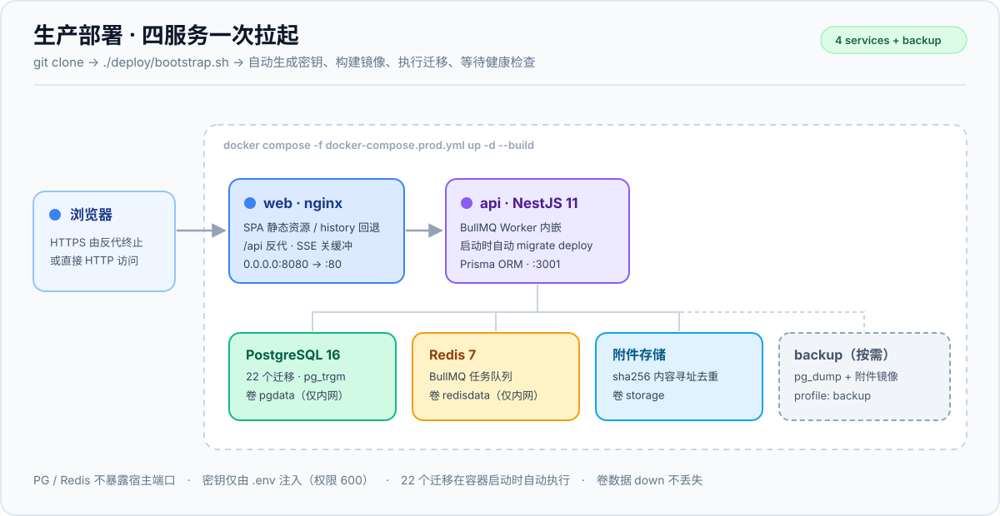
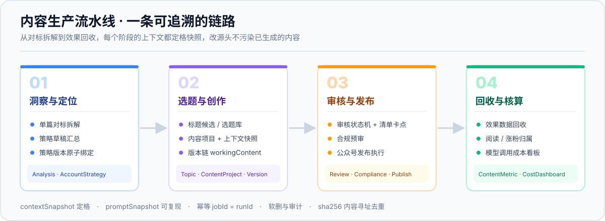
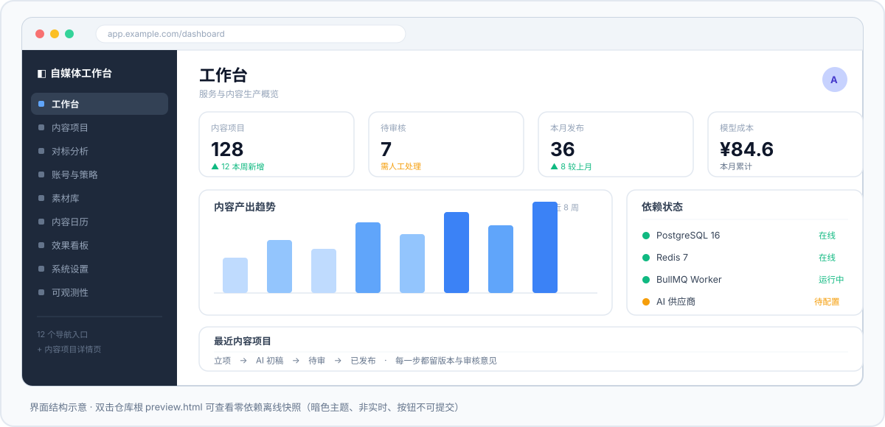

<div align="center">

# 🧩 自媒体工作台 · media-workbench

**把「对标拆解 → 账号策略 → 选题标题 → 内容创作 → 审核发布 → 效果回收 → 成本核算」串成一条可追溯的内容生产流水线**

[](LICENSE)
[](https://nodejs.org/)
[](https://nestjs.com/)
[](https://vuejs.org/)
[](https://www.postgresql.org/)
[](server/test/)

[🚀 一键部署](#-一键部署)　·　[🗺 功能地图](#-功能地图)　·　[🛠 本地开发](#-本地开发)　·　[📚 文档](#-文档索引)

</div>

> [!IMPORTANT]
> **诚实前置声明**：项目在开发环境通过构建、类型检查与 332 个单元测试，但**从未在真实 PostgreSQL / Redis / LLM 上跑通完整链路**。22 个迁移、登录 round-trip、BullMQ 消费、真实模型调用、Docker 镜像构建都属于首次上线验证项。健康检查在依赖不可用时如实返回 `unavailable`，不伪造通过。上线前请按 [部署指南第六节](deploy/README.md) 逐条验收。

---

## 🏗 架构：一次拉起四个服务



| 🚀 一键起全套 | 🔗 全链路可追溯 | 🔐 密钥不落地 |
| :--- | :--- | :--- |
| `bootstrap.sh` 自动生成密钥、构建镜像、跑迁移、等健康检查，不需要宿主机 Node / psql / nginx | `contextSnapshot` 定格上下文、`promptSnapshot` 可复现、内容版本链保留每次修改 | 密钥只走环境变量与 `*.example` 模板；供应商 Key 加密入库，日志与仓库里都看不到 |

---

## 🔄 业务流水线



---

## 🖥 界面一览



前端共 **12 个导航入口 + 1 个内容项目详情页**。想看真实渲染效果，双击仓库根的 [`preview.html`](preview.html)——零外部依赖的离线快照，非实时、按钮不可提交。

---

## 🚀 一键部署

`clone` 之后一条命令，前端 / API / PostgreSQL / Redis **全部起来**：

```bash
git clone https://github.com/fuyegongfang-star/media-workbench.git /opt/media-workbench
cd /opt/media-workbench
./deploy/bootstrap.sh
```

脚本自动完成：生成 64 位 `APP_MASTER_KEY`、96 位 `JWT_SECRET`、数据库口令与 16 位初始口令 → 清空模板里所有 `<...>` 占位符 → `.env` 权限 600 → `up -d --build` → 轮询 `/api/health` → 打印访问地址与**一次性初始口令**。

**依赖只有** Docker Engine 24+、Compose v2、openssl、GNU sed。已存在 `.env` 时绝不覆盖，避免密钥轮换导致库里已加密数据不可解密。

| 场景 | 命令 |
| :--- | :--- |
| 挂宝塔 / nginx 反代 + HTTPS | `./deploy/bootstrap.sh --domain https://wb.example.com --local` |
| 改对外端口 | `./deploy/bootstrap.sh --port 9000` |
| 只生成配置自检，不启动 | `./deploy/bootstrap.sh --env-only` |
| 已有镜像，快速重启 | `./deploy/bootstrap.sh --no-build` |
| 更新版本（自动增量迁移） | `git pull && ./deploy/bootstrap.sh` |
| 完整备份（库 + 附件） | `./deploy/backup.sh` |

> [!WARNING]
> 默认绑 `0.0.0.0` 且是 **HTTP 明文**。公网部署请在前面挂反代并启用 HTTPS，防火墙 + 云安全组只开 80/443，勿暴露 8080 / 5432 / 6379。首次登录后**立即修改初始口令**，并离线备份 `.env`（`APP_MASTER_KEY` 丢失则已加密数据不可解密）。

完整步骤、宝塔面板逐步操作、首次上线 10 项核验清单、故障对照表与回滚见 **[`deploy/README.md`](deploy/README.md)**。

---

## 🗺 功能地图

| 模块 | 主要能力 |
| :--- | :--- |
| 工作台 / 可观测性 | 服务健康、依赖状态、任务概览、运行日志 |
| 对标分析 / 账号与策略 | 单篇拆解、策略草稿、策略版本原子绑定、对标账号库 |
| 内容项目 | 选题标题 → 创作上下文 → 版本链 → 审核状态机 → 合规预审 |
| 起号计划 / 日历 / 素材库 / 批量操作 | 图片组拖拽、内容排期、素材沉淀、批量导入导出 |
| 效果看板 / 成本看板 | 发布回写、指标回收、模型调用成本核算 |
| 系统设置 | 站点设置、运营配置、供应商密钥（加密入库）、通知、备份 |

## 🧰 技术栈

| 层 | 选型 |
| :--- | :--- |
| 后端 | NestJS 11 + TypeScript，模块化单体 |
| 数据 | PostgreSQL 16 + Prisma 6（22 个迁移）、`pg_trgm` 检索 |
| 队列 | BullMQ + Redis 7，Worker **内嵌在 API 进程** |
| 前端 | Vue 3 + Vite 6 + vue-router + Pinia + Naive UI |
| AI | OpenAI 兼容供应商 / 检测 / 润色三个可替换 Provider |
| 部署 | Docker 多阶段构建 + nginx（SPA + `/api` 反代，SSE 关缓冲） |

---

<details>
<summary><b>🛠 本地开发（点击展开）</b></summary>

前置：Node.js >= 22、npm、PostgreSQL 16、Redis 7。没有本机数据库时用 `docker-compose.yml` 起依赖。

```bash
git clone https://github.com/fuyegongfang-star/media-workbench.git
cd media-workbench

cp .env.example .env          # 必填：把所有 <...> 换成真实值
npm run install:all           # 分别安装 server/ 与 web/ 依赖（未用 workspaces）
docker compose up -d          # 起 PG16 + Redis；已装本机数据库可跳过

npm run prisma:generate
npm run migrate:deploy        # 22 个迁移
npm run build                 # 构建 server + web
npm start                     # API: http://127.0.0.1:3001/api
npm --prefix web run dev      # 前端: http://127.0.0.1:5173（/api 已配代理）
```

Prisma CLI 从 `server/` 目录运行，若报读不到 `DATABASE_URL`，把 `.env` 再复制一份到 `server/.env`（同样已被忽略，不会入库）。

```bash
npm run typecheck                    # 前后端类型检查
npm run validate                     # prisma validate（同样需 DATABASE_URL）
npm run trial                        # 纯函数端到端流水线自检
npm run health                       # 需 API 已启动
node --test server/test/*.test.mjs   # 332 个单测
```

</details>

<details>
<summary><b>✅ 验证状态（点击展开）</b></summary>

| 项 | 结果 |
| :--- | :--- |
| `npm run build` / `npm run typecheck` | ✅ 通过 |
| 单元测试 | ✅ 332 / 332（27 个文件） |
| `prisma validate` / 迁移文件 | ✅ 22 个迁移目录均有 `migration.sql` |
| `preflight`（一键脚本生成的 `.env`） | ✅ PASS 25 / WARN 3 / FAIL 0，WARN 均为未配置 AI 密钥 |
| shell 脚本 | ✅ `sh -n` 通过、LF 换行、无 BOM |
| 真机 PostgreSQL / Redis / LLM 联调 | ⚠️ **待环境**，首次上线按核验清单逐条验证 |
| Docker 镜像构建与 compose 启动 | ⚠️ **待环境**，本机无 Docker |

暂无 CI，以上均为本机实跑结果，不是流水线徽章。

</details>

---

## 📚 文档索引

| 文档 | 内容 |
| :--- | :--- |
| [`deploy/README.md`](deploy/README.md) | **生产部署指南**（宝塔 / 命令行 / 核验清单 / 故障排查 / 回滚） |
| [`PRD评审报告.md`](PRD评审报告.md) | 需求缺口与风险评审 |
| [`技术方案与任务拆分.md`](技术方案与任务拆分.md) | 架构决策与任务拆分 |
| [`深入设计.md`](深入设计.md) | 四大高风险模块详细设计 |
| [`功能遗漏盘点.md`](功能遗漏盘点.md) | 基于真实运营场景的补漏清单 |
| [`开发排期.md`](开发排期.md) | 72 人天 / 15 周排期与任务编号 |
| [`进度.md`](进度.md) | 开发进度真相源（含每晚自验证据） |
| [`restore.md`](restore.md) | 备份与恢复手册 |
| [`trial-run.report.md`](trial-run.report.md) | 字段继承观察清单 |
| [`preview.html`](preview.html) | 零依赖离线界面快照 |

<details>
<summary><b>📁 目录结构（点击展开）</b></summary>

```
server/                  NestJS 模块、Prisma schema 与 22 个迁移、单元测试
web/                     Vue3 SPA（views / router / api / stores）
scripts/                 健康检查、preflight、备份、试运行、诊断脚本
deploy/                  bootstrap.sh、backup.sh、nginx 配置、entrypoint、模板、定时备份示例
docs/                    架构图 / 流水线图 / 界面示意图（SVG）
Dockerfile               三阶段多阶段构建
docker-compose.prod.yml  生产编排（postgres / redis / api / web / backup profile）
docker-compose.yml       本地开发依赖（PG16 + Redis）
```

</details>

---

## 🔐 安全约定

- 密钥与口令只走环境变量 + `*.example` 占位模板，禁止硬编码、禁止写入日志。
- 供应商 API Key 经 `SystemConfig.apiKeyEncrypted` 加密入库，前端只拿到脱敏视图。
- 数据库查询参数绑定、用户输入转义；上传 50MB 上限；附件按 sha256 内容寻址去重。
- 仓库不含 `.env`、`node_modules/`、`dist/`、`storage/`、`backups/` 及任何密钥材料。
- `.gitattributes` 锁定全仓 LF，避免 Linux 容器脚本因 CRLF 启动失败。

## 📄 许可证

[MIT](LICENSE) © 2026 fuyegongfang-star —— 可自由使用、修改、商用，保留版权声明即可。

---

<div align="center">

如果这个项目对你有用，点个 ⭐ 就是最大的支持；问题与建议欢迎提 Issue。

</div>
